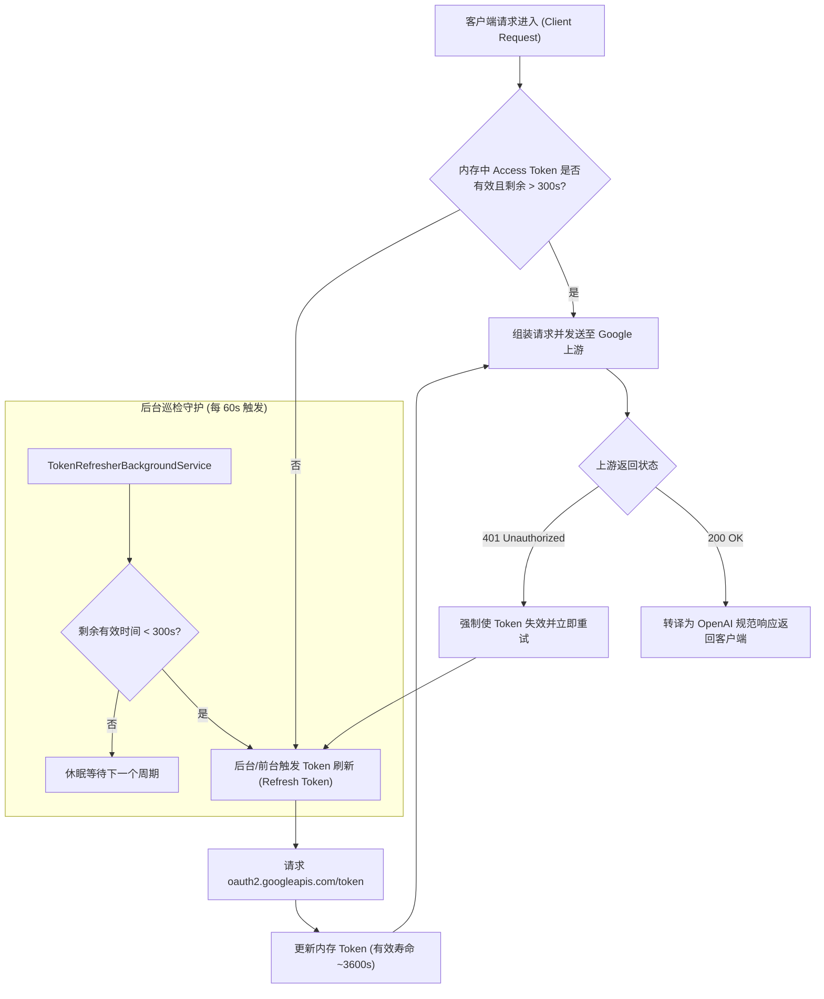
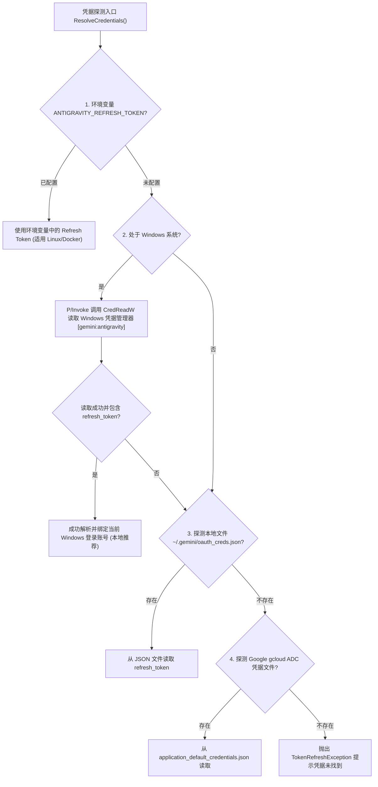

# AntigravityGateway 🚀

> **基于 Antigravity 官方账号的 OpenAI 兼容代理网关与双 Token 永续系统**

AntigravityGateway 是一个专为 AI Agent（Cursor、Dify、LangChain、Cline / Roo Code、Continue 等）打造的高性能本地/私有网关。它通过深度逆向 Google 官方 Antigravity 插件运行环境，自动从 Windows 凭据管理器中无感提取当前登录账号的 OAuth 凭据，并将其转化为完全符合 **OpenAI 官方规范** 的 API 接口（`/v1/chat/completions`、`/v1/models`、`/v1/health`）。

---

## 🌟 核心特性与技术突破

### 1. 🔄 双 Token 机制与自动永续保活 (Perpetual Token Lifecycle)
- **无感安全读取**：通过 Windows 底层 Win32 API（P/Invoke `advapi32.dll` 的 `CredReadW`）直接安全读取 Windows 凭据管理器中的 `gemini:antigravity`，完全无需用户重新登录、抓包或输入密码。
- **OAuth 2.0 双 Token 自动续期**：提取凭据中的 `refresh_token`，配合官方客户端凭据，定期向 `https://oauth2.googleapis.com/token` 刷新获取最新的 `access_token`（具备 `https://www.googleapis.com/auth/aicode` 核心权限）。
- **后台主动轮询保活 (`TokenRefresherBackgroundService`)**：后台每 60 秒定期巡检。当 Token 剩余有效时长少于 5 分钟或总时长的 10% 时，后台自动提前无缝刷新，避免请求到达时才发生冷启动耗时。
- **401 自愈重试**：当上游偶发鉴权失效时，网关原子化使当前 Token 失效并强制并发安全重新刷新后重试，实现真正意义上的 **7x24 小时无人值守永续运行**。



#### 🔑 Refresh Token 是如何获取的？（无感提取与多级探测）

网关在启动与运行期间，**完全不需要用户手动抓包、提取 Cookie 或输入账号密码**，而是通过内置的安全凭据解析引擎（[`AntigravityAccountService.cs`](src/AntigravityGateway/Services/AntigravityAccountService.cs)）从宿主系统中自动定位并解密提取。

##### 1. 本地存储位置与写入者
- 当用户在 Windows 系统中安装并登录 Google Antigravity 时，Antigravity 客户端会自动将 Google OAuth 2.0 授权凭据加密持久化保存在 **Windows 凭据管理器 (Windows Credential Manager)** 中；
- 目标凭据名称（Target Name）为：**`gemini:antigravity`**（凭据类型：`Generic Credential` 普通凭据）。

##### 2. Win32 P/Invoke 安全读取与解密
网关通过 P/Invoke 直接调用 Windows 核心底层动态库 `Advapi32.dll`：
```csharp
[DllImport("Advapi32.dll", EntryPoint = "CredReadW", CharSet = CharSet.Unicode, SetLastError = true)]
private static extern bool CredRead(string target, int type, int reservedFlag, out IntPtr credentialPtr);
```
- **免输密码与 DPAPI 安全保护**：调用 `CredReadW("gemini:antigravity", 1, ...)` 时，Windows 操作系统会自动利用当前登录用户的 DPAPI 密钥解密凭据二进制数据（`CredentialBlob`），全程静默在内存中完成，无需用户输入密码或产生任何系统弹窗。
- **凭据结构解析**：Blob 解密后是一个 JSON 结构，网关提取其中的核心字段：
  - `refresh_token`：长期有效的 Google OAuth 刷新令牌（形如 `1//04...`）；
  - `id_token`：网关通过 Base64 解码 JWT Payload 提取出当前绑定的 Google 邮箱（例如 `pingcunhe@gmail.com`）；
  - `access_token` 与初始过期时间。

##### 3. 多级凭据获取优先级（支持跨平台部署）
为了兼顾本地开箱即用与服务器/Docker 部署，网关实现了 4 级降级解析机制：



##### 4. 换取 Access Token 与主动永续
提取到 `refresh_token` 后，网关使用 Antigravity 官方客户端标识（`client_id` 与 `client_secret`）定期请求 Google 认证端点：
- **OAuth 端点**：`https://oauth2.googleapis.com/token`
- **获取权限**：自动获取包含 `https://www.googleapis.com/auth/aicode` 核心权限的全新 `access_token`；
- **后台保活**：`TokenRefresherBackgroundService` 每 60 秒轮询，在有效时长不足 300 秒时提前在后台静默刷新，确保外部 Agent（Cursor、Dify、LangChain 等）的长期请求永远不会因 Token 过期而中断。

### 2. ⚡ Antigravity 专属通道与后端优化
- **专用内部端点**：直连 Google 内部通道 `https://daily-cloudcode-pa.googleapis.com/v1internal`，指定 `aicode-consumers` 专属工程与 `antigravity/2.24.0` 客户端标识，避开常规 Cloud Code 订阅限制与 403 阻断。
- **全双工流式与聚合**：由于上游限制仅开放 `:streamGenerateContent?alt=sse`，AntigravityGateway 内部实现了高吞吐 SSE 解析器。当客户端请求 `stream=false` 时，网关在内存中以纳秒级高效聚合分块并输出标准 OpenAI 响应；当客户端请求 `stream=true` 时，零延迟透传 SSE 数据。

### 3. 🧠 Gemini 3.x 深度思考与多轮工具调用 (Thought Signature) 破局
- **思考标记 (Thought Signature) 完美适配**：Gemini 3.x（如 `gemini-3.8-flash-high`）在 Tool Calling 中引入了思维链签名校验机制，下游在回传函数结果时若缺少该签名上游将直接报 400 错误。
- **无状态 ID 编码创新**：AntigravityGateway 将 `(tool_name, thoughtSignature)` 进行 Base64Url 打包编码进标准的 OpenAI `tool_call_id`（`call_<encoded>`）。标准 Agent 无需做任何魔改即可直接原样传回，网关无状态解码还原，彻底解决多轮函数调用的断流痛点。
- **思考 Token 统计**：将 Gemini 的 `thoughtsTokenCount` 转化为 OpenAI 规范的 `usage.completion_tokens_details.reasoning_tokens`，精准支持思考过程审计。

### 4. 🔀 丰富模型生态与实测性能
自动探查并支持账户名下的 **24 个** 前沿模型，经实测均可毫秒级稳定调用：

| 模型标识 (Model ID) | 架构体系 | 思考能力 | 实测首字延迟 | 适用推荐场景 |
| :--- | :--- | :---: | :---: | :--- |
| **`gemini-3.8-flash-high`** *(默认)* | Google Gemini 3.x | ✅ 深度思考 | ~3.0s | **最强推荐**：智能最高、代码能力最强、配额最足 |
| **`gemini-3.8-flash`** | Google Gemini 3.x | ✅ 深度思考 | ~4.0s | 通用高精度任务 |
| **`gemini-2.5-flash`** | Google Gemini 2.5 | ⚡ 快速响应 | **~0.8s** | 极速对话、补全、摘要、分类任务 |
| **`claude-sonnet-4-6`** | Anthropic Claude | 🎯 超强编程 | **~1.6s** | **开发强推**：Antigravity 独家通道，低延迟编程 |
| **`claude-opus-4-6-thinking`** | Anthropic Claude | ✅ 思维链 | ~2.1s | 超复杂逻辑推导与系统设计 |
| **`gpt-oss-120b-medium`** | Open Weights | ⚡ 高效轻量 | ~1.5s | 开源大模型指令评测 |
| **`gpt-4o`** *(别名)* | 自动映射 | ✅ 深度思考 | ~3.6s | 兼容旧系统写死 `gpt-4o` 的场景 |

> [!NOTE]
> `gemini-2.5-pro` 在 Google 峰值期上游偶尔会报 503 `MODEL_CAPACITY_EXHAUSTED`（错误码 2010）。建议日常使用配额充足且具备深度思考的 **`gemini-3.8-flash-high`** 或 **`claude-sonnet-4-6`**。

---

## 🚀 快速启动指南

### 准备环境
- **操作系统**：Windows 10/11（已在本地登录 Antigravity），或 Linux/macOS/Docker（传入环境变量）
- **运行环境**：[.NET 8.0 或 .NET 10.0 SDK](https://dotnet.microsoft.com/download)
- **测试环境（可选）**：Python 3.10+ 及 `pip install openai requests`

---

### 方式 A：前台实时运行（开发与调试）
在终端中执行：
```powershell
.\scripts\start_gateway.ps1 -Port 5055
```
服务将在 `http://127.0.0.1:5055` 启动，并在控制台实时输出账号发现、Token 续期及每个 API 请求日志。

---

### 方式 B：后台静默守护运行（日常推荐）
若希望网关在后台长期静默运行，不占用终端窗口：
```powershell
# 1. 后台无窗口启动
.\scripts\start_background.ps1 -Port 5055

# 2. 随时检查健康状态
curl http://127.0.0.1:5055/v1/health

# 3. 需要退出时，一键停止
.\scripts\stop_gateway.ps1 -Port 5055
```
*(日志将自动记录在 `logs/gateway_stdout.log` 和 `logs/gateway_stderr.log`)*

---

### 一键执行全量闭环验证（100% 纯 .NET 10 测试套件）
项目包含完整的纯 **.NET 10 xUnit** 测试项目（[`tests/AntigravityGateway.Tests`](tests/AntigravityGateway.Tests)），直接引用微软与 OpenAI 官方发布的 `OpenAI` 官方 .NET NuGet 包，覆盖单元测试与端到端集成测试（健康检查、24 模型列举、非流式问答、实时流式 SSE、多轮工具调用与官方 SDK）：
```powershell
# 方式 1：执行自动化闭环验证脚本
.\scripts\verify_all.ps1

# 方式 2：使用 dotnet CLI 运行所有测试
dotnet test tests\AntigravityGateway.Tests\AntigravityGateway.Tests.csproj --no-build
```

---

## 💻 主流 Agent 与开发工具配置指南

AntigravityGateway 100% 遵照 OpenAI 官方 API 协议规范，所有支持自定义 OpenAI 接口的工具均可**免修改直接接入**。

### 1. Cursor 配置
1. 打开 Cursor：`Settings` -> `Features` -> `Models`；
2. 打开 `OpenAI API Key` 开关，填入：`sk-antigravity`；
3. 打开 `Override OpenAI Base URL`，填入：
   ```text
   http://127.0.0.1:5055/v1
   ```
4. 点击 `+ Add Model`，添加：
   - `gemini-3.8-flash-high`
   - `claude-sonnet-4-6`

---

### 2. Cline / Roo Code (VS Code 扩展)
1. 打开扩展设置界面；
2. **API Provider**：选择 `OpenAI Compatible`；
3. **Base URL**：`http://127.0.0.1:5055/v1`；
4. **API Key**：`sk-antigravity`；
5. **Model ID**：`gemini-3.8-flash-high` 或 `claude-sonnet-4-6`。

---

### 3. Continue.dev 配置
在 `~/.continue/config.json` 的 `models` 数组中添加：
```json
{
  "models": [
    {
      "title": "Gemini 3.8 Flash (High)",
      "provider": "openai",
      "model": "gemini-3.8-flash-high",
      "apiBase": "http://127.0.0.1:5055/v1",
      "apiKey": "sk-antigravity"
    },
    {
      "title": "Claude 3.7 Sonnet (Antigravity)",
      "provider": "openai",
      "model": "claude-sonnet-4-6",
      "apiBase": "http://127.0.0.1:5055/v1",
      "apiKey": "sk-antigravity"
    }
  ]
}
```

---

### 4. Dify 接入
1. 进入 Dify 控制台 -> **设置** -> **模型供应商**；
2. 选择 **OpenAI-API-compatible**，点击「添加模型」：
   - **模型类型**：`LLM`
   - **模型名称**：`gemini-3.8-flash-high`
   - **API Key**：`sk-antigravity`
   - **API Base URL**：`http://127.0.0.1:5055/v1`
   - **函数调用 (Function Call)**：支持
   - **Agent 思考 (Reasoning)**：支持

---

### 5. 官方 .NET C# OpenAI SDK (NuGet: OpenAI 2.x)
```csharp
using OpenAI;
using OpenAI.Chat;
using System.ClientModel;

// 1. 初始化官方客户端指向网关
var clientOptions = new OpenAIClientOptions { Endpoint = new Uri("http://127.0.0.1:5055/v1") };
var client = new OpenAIClient(new ApiKeyCredential("sk-antigravity"), clientOptions);
var chatClient = client.GetChatClient("gemini-3.8-flash-high");

// 2. 问答请求
ChatCompletion completion = await chatClient.CompleteChatAsync("9.11 和 9.9 谁更大？请给出简短理由。");
Console.WriteLine(string.Concat(completion.Content.Select(c => c.Text)));

// 3. 实时流式传输
AsyncCollectionResult<StreamingChatCompletionUpdate> stream = chatClient.CompleteChatStreamingAsync("从 1 数到 5");
await foreach (var update in stream)
{
    foreach (var part in update.ContentUpdate)
    {
        Console.Write(part.Text);
    }
}
```

---

### 6. 官方 Python OpenAI SDK
```python
from openai import OpenAI

client = OpenAI(
    base_url="http://127.0.0.1:5055/v1",
    api_key="sk-antigravity"
)

# 1. 基础问答（包含思维链统计）
completion = client.chat.completions.create(
    model="gemini-3.8-flash-high",
    messages=[
        {"role": "user", "content": "9.11 和 9.9 谁更大？请给出简短理由。"}
    ]
)
print("回答:", completion.choices[0].message.content)
print("思考 Token:", completion.usage.completion_tokens_details.reasoning_tokens)

# 2. 实时流式传输
stream = client.chat.completions.create(
    model="claude-sonnet-4-6",
    messages=[{"role": "user", "content": "用 Python 写一个斐波那契函数"}],
    stream=True
)
for chunk in stream:
    if chunk.choices[0].delta.content:
        print(chunk.choices[0].delta.content, end="", flush=True)
print()
```

---

### 6. LangChain 接入
```python
from langchain_openai import ChatOpenAI

llm = ChatOpenAI(
    base_url="http://127.0.0.1:5055/v1",
    api_key="sk-antigravity",
    model="gemini-3.8-flash-high",
    temperature=0.2
)

response = llm.invoke("简述量子纠缠的物理意义。")
print(response.content)
```

---

## ⚙️ 环境变量与高级配置

配置文件位于 `src/AntigravityGateway/appsettings.json`，可通过环境变量灵活覆盖：

| 环境变量 | 默认值 | 说明 |
| :--- | :--- | :--- |
| `GATEWAY_API_KEY` | *(空)* | 网关对外认证密钥，为空则允许任意请求访问 |
| `GEMINI_DEFAULT_MODEL` | `gemini-3.8-flash-high` | 请求未携带模型名称时的默认路由目标 |
| `ANTIGRAVITY_AUTH_SOURCE` | `Auto` | 认证源策略：`Auto`（优先凭据管理器）、`File`、`Env` |
| `ANTIGRAVITY_CREDENTIAL_TARGET`| `gemini:antigravity` | Windows 凭据管理器目标名称 |
| `ANTIGRAVITY_REFRESH_TOKEN` | *(空)* | 手动指定 Refresh Token（用于 Linux 或 Docker 无头部署） |
| `ANTIGRAVITY_PROJECT` | `aicode-consumers` | Google 上游专属项目 ID |
| `ANTIGRAVITY_MAX_CONCURRENCY` | `2` | 向上游发起请求的最大并发数限制 |

### 跨平台与 Docker 部署
在没有安装 Antigravity 的 Linux 服务器或 Docker 容器中，可通过传入提取的 Refresh Token 启动：
```bash
docker compose up -d
```
或直接通过环境变量启动：
```bash
export ANTIGRAVITY_REFRESH_TOKEN="1//04xxxxxxxxxxxxxxxxxx"
dotnet run --project src/AntigravityGateway/AntigravityGateway.csproj --urls "http://0.0.0.0:5055"
```

---

## ❓ 常见问题排查 (FAQ)

### Q1: 提示端口 5055 被占用？
启动脚本支持自定义端口，例如更换为 `5056`：
```powershell
.\scripts\start_gateway.ps1 -Port 5056
```
客户端 Base URL 同步修改为 `http://127.0.0.1:5056/v1` 即可。

### Q2: 报错 `Antigravity credential not found`？
说明当前 Windows 电脑未登录 Antigravity。请在 Antigravity 插件中登录任意 Google 账号，登录成功后系统会自动在凭据管理器生成 `gemini:antigravity`，网关即可无感读取。

### Q3: 为什么请求某些模型出现 503 `MODEL_CAPACITY_EXHAUSTED`？
这是 Google 云端对该模型的并发配额保护（尤其是 `gemini-2.5-pro` 在工作日高峰）。将客户端模型切换为 **`gemini-3.8-flash-high`** 或 **`claude-sonnet-4-6`** 即可恢复极速响应。

### Q4: 如何确认双 Token 已经成功自动永续？
访问 `http://127.0.0.1:5055/v1/health`：
- 若返回 `status: healthy`；
- `remainingSeconds` 会在接近 300 秒时自动重置回约 3540 秒；
- 证明后台定时轮询保活服务与 OAuth 2.0 刷新工作完全正常。

---

## 📄 开源许可证
本项目基于 MIT License 协议开源。
